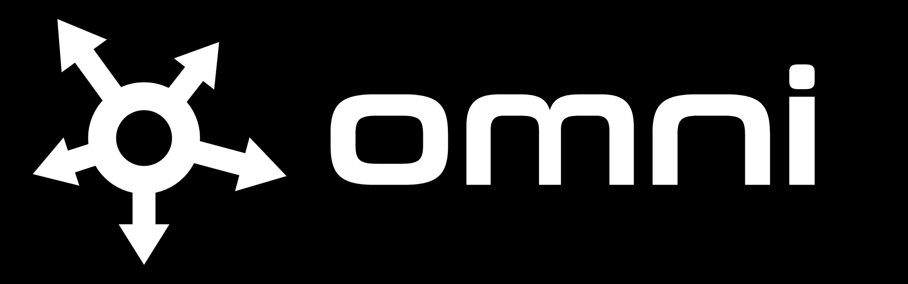
<p align="center">
    <a href="context/hardware.md"></a>
    <a href="cloud/try_turn.py"></a>
    <a href="firmware/speech.py"></a>
    <a href="LICENSE"></a>
</p>
<hr>

> [!NOTE]
> Ask Omni to generate an app, and it builds it for you in real time.
> Speak again to change that app, ask a question, or navigate the UI.

## What can Omni do?

<table align="center">
    <tr>
        <td align="center" width="240"><b>01. Voice Navigation</b></td>
        <td align="center" width="240"><b>02. Kinetic Wheel Browsing</b></td>
        <td align="center" width="240"><b>05. Generative App Genesis</b></td>
    </tr>
    <tr>
        <td align="center">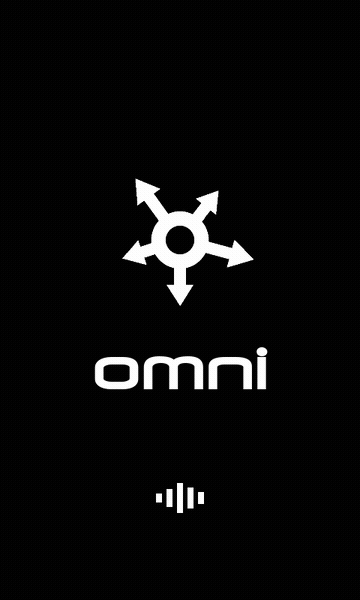</td>
        <td align="center">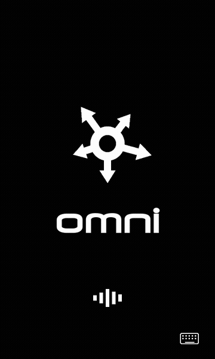</td>
        <td align="center">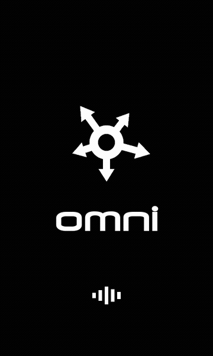</td>
    </tr>
    <tr>
        <td align="center"><sub><i>Push-to-talk voice navigation</i></sub></td>
        <td align="center"><sub><i>Rotary kinetic launcher wheel</i></sub></td>
        <td align="center"><sub><i>Dynamic micro-app compilation</i></sub></td>
    </tr>
</table>

## System architecture

Vosk turns speech into text on the device. Omni firmware sends that text and the contract to Gemini, and one structured turn comes back. ElevenLabs speaks the line. The simulator runs that same firmware before a feature ships.

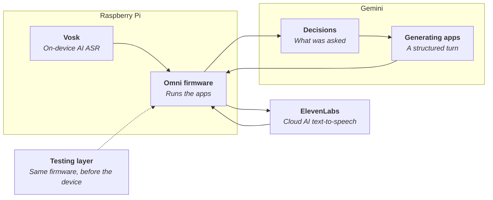

## AI contract

A language model answers differently every time. The contract makes every reply a fixed shape, so the firmware follows the operation instead of the wording.

```json
{
  "op": "mutate",
  "say": "Point for Logan.",
  "actions": [{ "action": "increment", "target": "logan", "amount": 1 }]
}
```

The sentence can change. The operation is what runs. The schema is the [contract](contract/README.md).

## AI reasoning

Gemini decides what was asked before it answers. The same words can mean a new app, a change to one already on the device, a page to open, or a question.

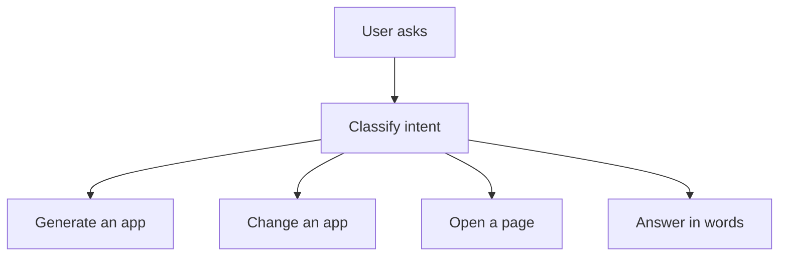

## Simulator

<p align="center">
    <a href="https://github.com/LThmly/Omni/actions/workflows/tests.yml"></a>
    <a href="sim/README.md"></a>
</p>

<p align="center">
    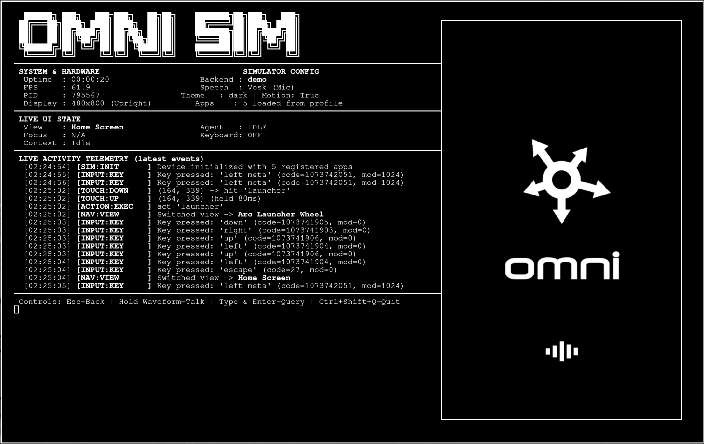
</p>

The laptop runs the same firmware as the Pi, so a feature is built and tried there before it ships to the device. The tests cover that firmware, speech, generated apps, speaker audio, and the contract. A malformed reply, or a failed Gemini call, is rejected instead of saved as an app.

```sh
sh sim/run.sh
```

## Hardware layout

<p align="center">
    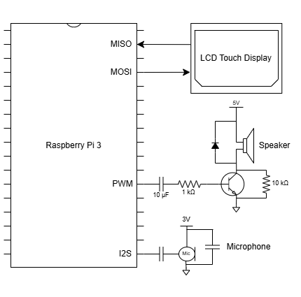
</p>

The Pi, the 5" display, the microphone, and the speaker had to live in one handheld, so the shell is a top and bottom cover around that stack. The speaker is a small driver on the Pi's PWM pin, which leaves the I2S bus for the microphone.

## Prototype

<p align="center">
    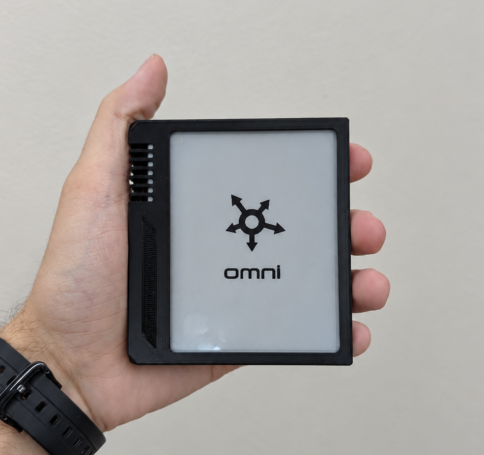
</p>

The first Omni was a smaller board: a Seeed XIAO ESP32-S3 and an e-paper panel. Partial refresh still left the screen too slow for the apps to feel real-time, so the display moved to the LCD. That firmware is on [eink-firmware](https://github.com/LThmly/Omni/tree/eink-firmware).

## Final design

<p align="center">
    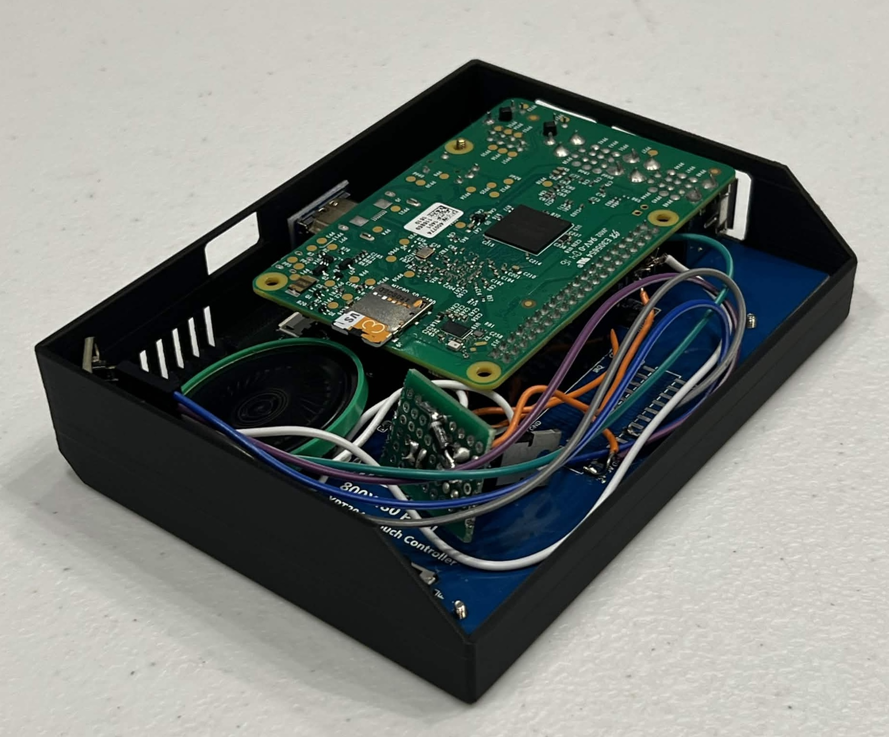
    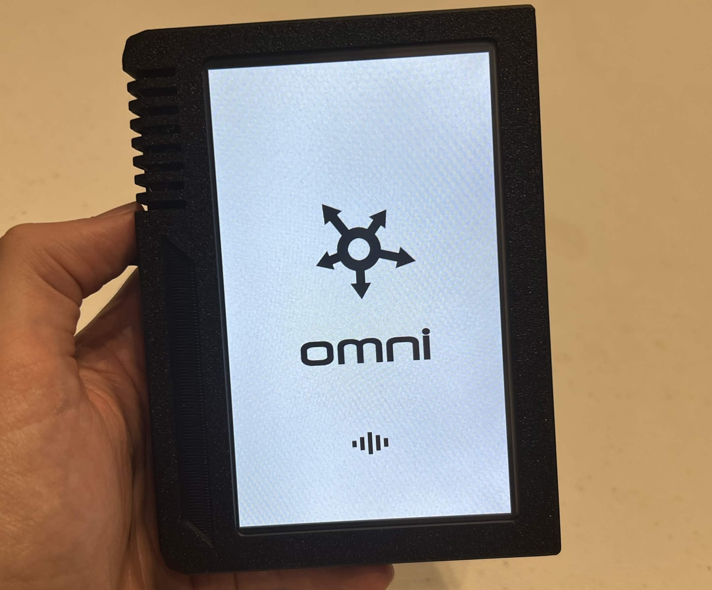
</p>

The finished Omni is a Raspberry Pi 3 Model B, a 5" touch LCD, an I2S microphone, and a speaker on PWM. Vosk turns speech into text on the Pi, Gemini builds the app, and ElevenLabs says it back through the speaker.

## Check out Omni

<p align="center">
    <a href="TODO">Demo video</a>
    &nbsp;·&nbsp;
    <a href="https://devpost.com/software/omni-f362rd">Devpost</a>
</p>

## Team

<table align="center">
    <tr>
        <td align="center" width="180">
            <a href="https://github.com/cannon-spencer"></a>
            <br>
            <a href="https://github.com/cannon-spencer"><b>Cannon Spencer</b></a>
        </td>
        <td align="center" width="180">
            <a href="https://github.com/LThmly"></a>
            <br>
            <a href="https://github.com/LThmly"><b>Logan Thomley</b></a>
        </td>
        <td align="center" width="180">
            <a href="https://github.com/Davis-Lester"></a>
            <br>
            <a href="https://github.com/Davis-Lester"><b>Davis Lester</b></a>
        </td>
        <td align="center" width="180">
            <a href="https://github.com/code-jasoo"></a>
            <br>
            <a href="https://github.com/code-jasoo"><b>Jason Iduyan</b></a>
        </td>
    </tr>
</table>

<p align="center">
    <a href="https://xii.swamphacks.com/"></a>
    &nbsp;&nbsp;
    <a href="https://mlh.io/"></a>
    <br>
    <sub>SwampHacks XII · <a href="https://mlh.io/">Major League Hacking</a></sub>
</p>
