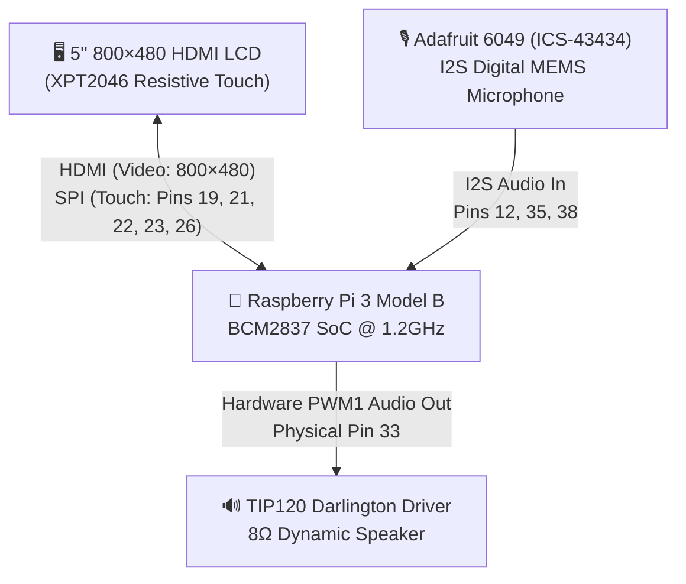

<div align="center">

# ✦ O M N I ✦
### *The On-Demand Generative App Hardware Companion*

[](sim/README.md)
[](context/hardware.md)
[](#-the-hardware-evolution-e-ink-prototype--flagship-touch-companion)
[](cloud/try_turn.py)
[](firmware/speech.py)
[](LICENSE)

<br/>

For the current simulator architecture, UI behavior, and complete development/deployment workflow, start with the [UI agent handoff](docs/UI_AGENT_HANDOFF.md). Coding agents should also read [AGENTS.md](AGENTS.md).


<br/>

**Omni** bridges the physical and digital divide: a dedicated handheld device that **dynamically synthesizes, compiles, and runs bespoke tactile micro-apps the instant you speak.**

[**Desktop Simulator (Run Now)**](#-the-cross-platform-desktop-simulator) • [**App Showcase**](#-user-experience--app-showcase) • [**E-Ink & Hardware Evolution**](#-the-hardware-evolution-e-ink-prototype--flagship-touch-companion) • [**Pi Deployment**](#-deploying-to-the-raspberry-pi) • [**Demo Script**](#-hackathon-demo-showcase-script)

</div>

---

## 💡 The Problem & The Vision

### Why Voice Assistants and AI Pins Fail
First-generation AI hardware devices (like the Humane AI Pin and Rabbit R1) and legacy smart assistants (Siri, Alexa) suffer from three fatal flaws:
1. **They are Ephemeral:** You ask a question, the device speaks an answer, and the information disappears forever. You cannot tap, toggle, or revisit the state.
2. **Brittle Web Automations:** Cloud web-scraping agents break the moment an underlying website changes its CSS.
3. **Voice-Only Fatigue:** Speaking every single command is exhausting. Checking off a grocery item or incrementing a game score should take **one silent tap**, not an awkward conversation.

### The Omni Breakthrough: *On-Demand Generative Apps*
Omni treats the user interface as a fluid, real-time generative canvas. You never browse an app store, write a line of code, or configure a template. 

When you ask Omni for something new:
1. **Gap Detection:** Omni searches its local registry. If no existing tool satisfies your intent, it instantly designs one.
2. **App Genesis:** Powered by multimodal Gemini and the **Omni Component Contract**, it declares a typed schema binding state, interactive buttons, progress bars, and checkboxes into an executable micro-app in under **2 seconds**.
3. **Tactile Persistence:** The newly minted app mounts permanently into your physical device. You can interact with it via **touch on the glass** or continue updating it by **voice**.

---

## 💻 The Cross-Platform Desktop Simulator

> [!TIP]
> **You don't need physical hardware to experience Omni!**  
> The repository includes a **pixel-perfect desktop simulator** that runs the exact same 60 FPS Pygame engine, kinetic animations, local Vosk ASR, and generative app contract as the Raspberry Pi.

<div align="center">
  
</div>

### 1. Instant 30-Second Setup

Works out-of-the-box on **macOS**, **Linux**, and **Windows**:

```bash
# Clone the repository
git clone https://github.com/LThmly/Omni.git
cd Omni

# Create virtual environment & install simulator dependencies
python3 -m venv .venv
source .venv/bin/activate       # On Windows: .venv\Scripts\activate
pip install -r sim/requirements.txt
```

### 2. Launch Omni

```bash
# Run immediately (100% offline demo mode, zero API keys required!)
sh sim/run.sh
```

### 3. Simulator Superpowers & Modes

| Mode | Command | Description |
| :--- | :--- | :--- |
| **Offline Zero-Config** | `sh sim/run.sh` | Instant local demo generation. No internet, servers, or API keys needed. |
| **Real Gemini Cloud AI** | `sh sim/run.sh --backend gemini` | Queries Google Gemini Flash live to synthesize new apps dynamically. *(Requires `GEMINI_API_KEY` in `.env`)* |
| **Local Stub Server** | `sh sim/run.sh --backend stub` | Routes requests through the local HTTP turn server (`cloud/stub_server.py`) at `127.0.0.1:8787`. |
| **Live Microphone Speech** | `sh sim/run.sh --speech vosk` | Offline speech recognition via on-device Vosk neural model. Run `.venv/bin/python sim/setup_speech.py` once to download the 40MB model. |

### Simulator Controls
* **Touch & Drag:** Click and drag with your mouse to scroll long lists or spin the kinetic wheel.
* **Push-to-Talk:** Click and hold the bottom waveform bar to record speech; release to submit.
* **Physical Keyboard:** Type any request directly and press `Enter`.
* **On-Screen Keyboard:** Tap inputs to open the built-in virtual touch keyboard.
* **App Reset:** Press `Ctrl+D` to restore default apps and clear generated scratchpads.
* **Quit:** Press `Ctrl+Shift+Q` or `Escape`.

---

## 📱 User Experience & App Showcase

Omni runs a custom, hardware-accelerated **60 FPS portrait interface (480×800)** rotated natively onto an 800×480 landscape display.

### 🌟 Flagship User Journey: App Genesis

| Step | User Intent / Action | Omni On-Screen Response | System Operation |
| :---: | :--- | :--- | :--- |
| **1** | Hold the talk bar: *"Add milk to my shopping list."* | Waveform pulses live; on-device Vosk streams real-time speech transcription. | Voice audio is captured non-blocking via microphone. |
| **2** | Release talk bar. | Dialog pops: *"You don't have a shopping list yet. Make one?"* with `[ Yes, create it ]` / `[ Cancel ]`. | Intent parsed; gap detected; Gemini proposes `checklist` app. |
| **3** | Tap **`[ Yes, create it ]`** on the touchscreen. | The new Shopping List immediately mounts and slides into view with **Milk** as item #1. | App registered into local JSON registry. |
| **4** | Later: *"Add eggs and iced coffee."* | Checked state persists; new items appear at the bottom. | Fast delta mutation applied to existing state. |
| **5** | Tap rows directly with your finger. | Checkboxes strike through and toggle with tactile audio chimes. | Low-latency local touch input handled directly in pygame. |

### 🛠️ Built-in & Generative Micro-App Ecosystem
* **📋 Checklists:** Dynamic grocery, packing, and task lists with instant touch toggling.
* **🏓 Scoreboards:** Live competition counters with large tactile increment (`+`) and decrement (`−`) touchpads.
* **💧 Progress Trackers:** Daily hydration, fitness, and Pomodoro focus timers with animated fill bars.
* **📝 Notes:** Persistent scratchpad with an integrated on-screen QWERTY touch keyboard.
* **🧮 Calculator:** Fast, sandboxed AST-evaluated scientific arithmetic pad.
* **⏰ Clock:** Dual 12-hour / 24-hour precision chronometer with smooth typography.
* **⚙️ Settings:** Real-time persistence for dark/light themes, motion reduction, text scaling, and preview wait timing.
* **🎡 Kinetic Launcher Wheel:** A circular rotary menu inspired by high-end physical synthesizers, navigable via drag, wheel, or arrow keys.

---

## 📜 The Hardware Evolution: E-Ink Prototype ➔ Flagship Touch Companion

Omni’s hardware engineering journey evolved through two distinct, complementary physical computing paradigms:

```
┌──────────────────────────────────────────────┐        ┌──────────────────────────────────────────────┐
│       PHASE 1: THE E-INK PROTOTYPE           │        │       PHASE 2: THE FLAGSHIP TOUCH COMPANION  │
│         (Branch: origin/eink-firmware)       │        │                   (Branch: main)             │
├──────────────────────────────────────────────┤        ├──────────────────────────────────────────────┤
│ • Seeed Studio XIAO ESP32-S3 Microcontroller │        │ • Raspberry Pi 3 Model B (Quad-Core 1.2GHz)  │
│ • Ultra-low-power ambient E-Paper Display    │───────>│ • 5.0" 800×480 HDMI LCD (Rotated 480×800)    │
│ • 5-Way Rotary Thumbwheel Switch Navigation  │        │ • XPT2046 Resistive Touchscreen Interface    │
│ • Week-long battery life for ambient glance  │        │ • Adafruit 6049 I2S MEMS Mic + TIP120 Speaker│
│ • Embedded C++ / PlatformIO firmware stack   │        │ • 60 FPS kinetic animations + neural TTS     │
└──────────────────────────────────────────────┘        └──────────────────────────────────────────────┘
```

### 1. Phase 1: The Original Ultra-Low-Power E-Ink Prototype
*(Preserved in branch [`origin/eink-firmware`](https://github.com/LThmly/Omni/tree/eink-firmware))*

<div align="center">
  
  <p><sub><em>The original Seeed Studio XIAO ESP32-S3 E-Paper prototype with tactile 5-way navigation thumbwheel</em></sub></p>
</div>

Omni began with a vision for calm, zero-distraction ambient computing:
* **Core Microcontroller:** **Seeed Studio XIAO ESP32-S3** with Wi-Fi and Bluetooth.
* **Display:** High-contrast multi-bit **E-Paper (E-Ink) display**, readable in direct sunlight with zero backlight glare.
* **Input:** A physical **5-way mechanical navigation thumbwheel switch** (`firmware/src/nav_switch.cpp`) providing tactile rotary scrolling, directional clicks, and press-to-select navigation without fingerprints on the screen.
* **Battery Life:** True deep-sleep standby consuming microamps, running for days on a single LiPo cell.
* **Codebase:** Native C++ built with PlatformIO (`firmware/src/eink_display.cpp`, `firmware/src/app_model.cpp`).

### 2. Phase 2: The Flagship 60 FPS Touchscreen Companion
*(Active on [`main`](https://github.com/LThmly/Omni))*

To realize fluid kinetic micro-apps, live voice waveform feedback, and sub-second touch responsiveness, Omni expanded into a standalone Linux-based handheld computing stack:



#### Component Bill of Materials (BOM)

| Component | Specification | Role in Omni | Connection / Interface |
| :--- | :--- | :--- | :--- |
| **Compute Board** | **Raspberry Pi 3 Model B** (Quad-Core 1.2GHz, 1GB RAM) | Central operating system, ASR, Pygame UI, audio pipeline | Core Controller |
| **Display Panel** | **5.0" 800×480 HDMI LCD** with XPT2046 controller | Touchscreen portrait interface (rotated 90° to 480×800) | Full-size HDMI + SPI (Pins 19, 21, 22, 23, 26) |
| **Microphone** | **Adafruit 6049 (ICS-43434)** I2S MEMS Microphone | Studio-quality digital push-to-talk voice capture | I2S Hardware Bus (Pins 1, 6, 12, 35, 38) |
| **Audio Output** | **8Ω 2-Wire Dynamic Speaker** + **TIP120 Darlington Transistor** | Text-to-speech voice playback & tactile UI chimes | BCM Hardware PWM1 (Physical Pin 33) |
| **Snubber Diode** | **1N4001** Flyback Diode | Absorbs inductive kickback from the voice coil | Parallel with speaker terminals |
| **Power Supply** | Official 5.1V / 2.5A Micro-USB PSU | Clean power with zero voltage sagging | Micro-USB Port |

#### 40-Pin Header Wiring Matrix

The 5" LCD uses a 26-pin socket (Pins 1–26), leaving **Pins 27–40 open and unblocked** for clean wiring:

| Pi Pin # | BCM GPIO | Signal / Net | Connected To |
| :---: | :---: | :--- | :--- |
| **Pin 1** | `3.3V` | VDD Power | Adafruit 6049 Mic `3V` |
| **Pin 2 / 4** | `5.0V` | VCC Power | 8Ω Speaker (+) & 1N4001 Diode (Cathode / Stripe) |
| **Pin 6** | `GND` | Ground | Adafruit 6049 Mic `GND` & `SEL` (bridged to GND for Left channel) |
| **Pin 12** | `GPIO 18` | `PCM_CLK` (I2S Clock) | Adafruit 6049 Mic `BCLK` |
| **Pin 33** | `GPIO 13` | `PWM1` (Audio Out) | $1\text{ k}\Omega$ Resistor $\rightarrow$ TIP120 Transistor Base (Pin 1) |
| **Pin 34** | `GND` | Power Ground | TIP120 Transistor Emitter (Pin 3) |
| **Pin 35** | `GPIO 19` | `PCM_FS` (I2S Word Select) | Adafruit 6049 Mic `LRCL` |
| **Pin 38** | `GPIO 20` | `PCM_DIN` (I2S Data In) | Adafruit 6049 Mic `DOUT` |
| **—** | `Collector` | TIP120 Pin 2 (Center) | 8Ω Speaker (—) & 1N4001 Diode (Anode / Plain) |

---

## 🥧 Deploying to the Raspberry Pi

Deploying code to the physical device is a single automated command with SHA verification and rollback protection:

```bash
# 1. Automatic One-Shot Deploy (runs tests, syncs files, restarts display)
python3 firmware/deploy.py omni@100.124.54.78 --backend gemini

# 2. Or run manually via SSH on the Pi desktop
ssh omni@100.124.54.78
cd ~/Omni
sh firmware/demo.sh
```

### Hardware Verification Diagnostics

Test each physical subsystem individually from the Pi terminal:

```bash
# Test the TIP120 PWM Speaker
python3 firmware/speaker.py --beep
python3 firmware/hold_tone.py         # Continuous 440 Hz tone (Ctrl+C to stop)

# Test ElevenLabs Speech Output
python3 firmware/speaker.py --say "Omni online and ready."

# Stop or restart the running kiosk
python3 firmware/phone.py --stop
```

---

## 🧪 Comprehensive Test Suite

Omni is built with continuous verification across firmware, cloud contracts, and hardware drivers:

```bash
# Run all unit tests
python -m unittest discover -s firmware -p 'test_*.py'
python -m unittest discover -s cloud -p 'test_*.py'
```

* **`test_native_ui.py`:** Validates 60 FPS frame rendering, kinetic wheel physics, touch coordinates, and local app state mutations.
* **`test_contract.py`:** Validates JSON schema adherence, component fixtures, and Gemini intent classifiers.
* **`test_speaker.py`:** Tests PCM wave generation, volume headroom, and non-blocking playback threads.
* **`test_speech.py`:** Tests Vosk partial hypotheses buffering and final segment synthesis.

---

## 🏆 Hackathon Demo Showcase Script

During judging, demo this continuous 3-minute flow to showcase the full stack:

1. **Hardware Intro (0:00 - 0:30):** Show the handheld Pi 3B, 5" touch LCD, custom I2S microphone soldering, and transistor speaker stage. Mention the ultra-low-power ESP32 E-Ink prototype origins.
2. **Offline Velocity (0:30 - 1:00):** Spin the kinetic wheel. Open Notes and type with the touch keyboard. Toggle 12/24-hour time in Clock.
3. **App Genesis Demo (1:00 - 2:00):** Hold the talk bar: *"Start a ping-pong match between Lester and Logan."* Watch Gemini synthesize the scoreboard app live, tap `[ Yes, create it ]`, and tap the `+` buttons to score points.
4. **Natural Mutation (2:00 - 2:45):** Hold the talk bar: *"Add three points to Logan."* Watch the scoreboard update hands-free while ElevenLabs speaks confirmation through the speaker.
5. **Architectural Wrap-up (2:45 - 3:00):** Highlight the local contract validator, modular schema architecture, and cross-platform desktop simulator.

---

## 👥 The Omni Team

Built with ❤️ for the Hackathon by:
* **Lester** — Hardware Engineering, Audio Circuitry, Firmware & Pi Kernel Bringup
* **Logan Thomley** — Software Architecture, Component Contract, Pygame UI & Speech Integration
* **Cannon Spencer** — Audio Synthesis, TTS Pipeline & Cloud Turn Integration
* **Jason** — ESP32-S3 E-Ink Firmware & PlatformIO Architecture

---

<div align="center">
  <sub>Omni is open-source software licensed under the <a href="LICENSE">MIT License</a>.</sub>
</div>
