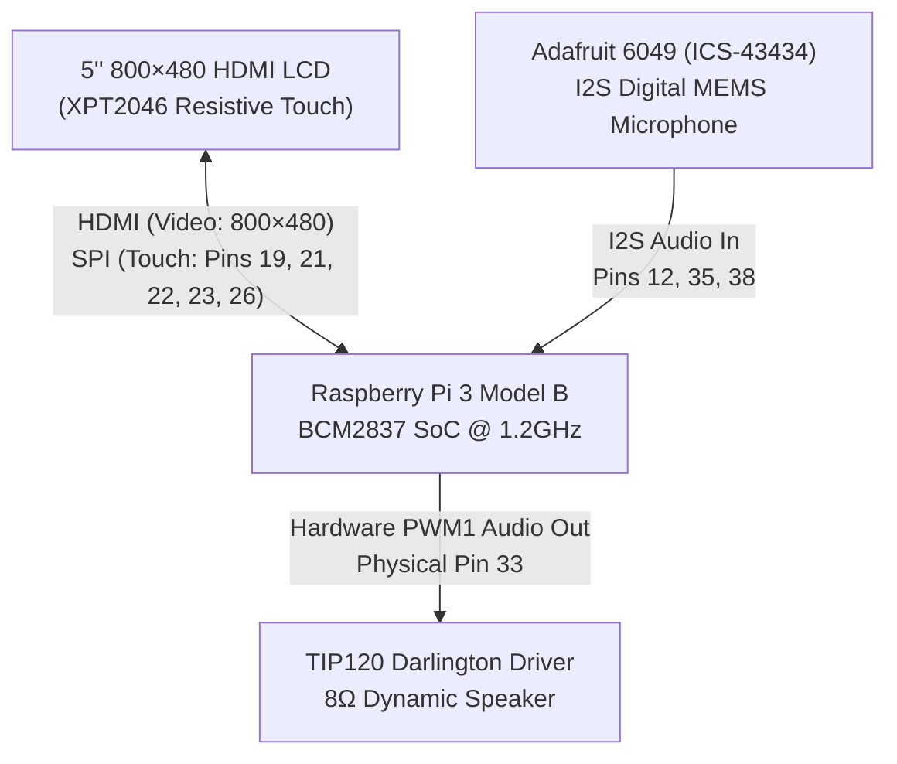
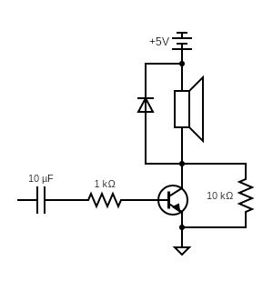
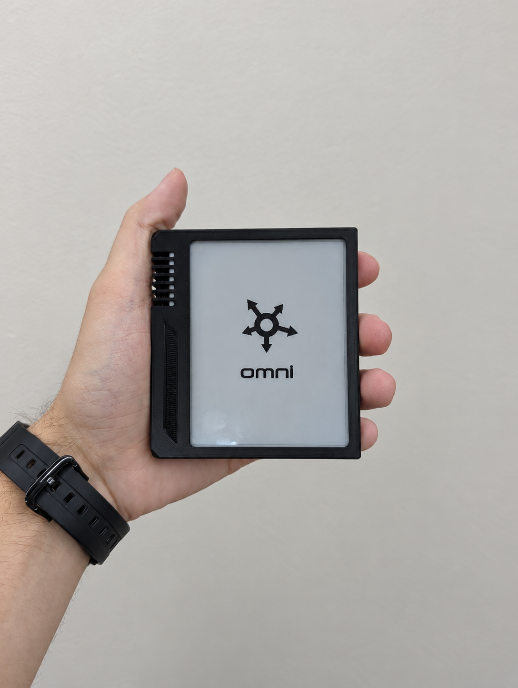

<div align="center">

# OMNI
### *The On-Demand Generative App Hardware Companion*

[](sim/README.md)
[](context/hardware.md)
[](cloud/try_turn.py)
[](firmware/speech.py)
[](LICENSE)

<br/>


**Omni** bridges the physical and digital divide: a dedicated handheld device that **dynamically synthesizes, compiles, and runs bespoke tactile micro-apps the instant you speak.**

<br/>

| **01. Voice Navigation** | **02. Kinetic Wheel Browsing** | **05. Generative App Genesis** |
| :---: | :---: | :---: |
|  |  |  |
| <sub><em>Push-to-talk voice navigation</em></sub> | <sub><em>Rotary kinetic launcher wheel</em></sub> | <sub><em>Dynamic micro-app compilation</em></sub> |

<br/>

[**Current Platform & Features**](#current-platform--features) • [**Custom Speaker Hardware**](#custom-speaker-hardware) • [**Screen Simulator**](#the-screen-simulator) • [**Design Process & E-Ink**](#design-process--the-e-ink-prototype)

</div>

---

## Current Platform & Features

Omni runs a custom, hardware-accelerated **60 FPS portrait interface (480×800)** rotated natively onto an 800×480 landscape display. It combines responsive on-device physical computing with generative cloud intelligence to deliver real-time tactile micro-apps.

### Hardware Architecture & Stack



#### Component Bill of Materials (BOM)

| Component | Specification | Role in Omni | Connection / Interface |
| :--- | :--- | :--- | :--- |
| **Compute Board** | **Raspberry Pi 3 Model B** (Quad-Core 1.2GHz, 1GB RAM) | Central operating system, ASR, Pygame UI, audio pipeline | Core Controller |
| **Display Panel** | **5.0" 800×480 HDMI LCD** with XPT2046 controller | Touchscreen portrait interface (rotated 90° to 480×800) | Full-size HDMI + SPI (Pins 19, 21, 22, 23, 26) |
| **Microphone** | **Adafruit 6049 (ICS-43434)** I2S MEMS Microphone | Studio-quality digital push-to-talk voice capture | I2S Hardware Bus (Pins 1, 6, 12, 35, 38) |
| **Audio Output** | **8Ω 2-Wire Dynamic Speaker** + **TIP120 Darlington Transistor** | Text-to-speech voice playback & tactile UI chimes | BCM Hardware PWM1 (Physical Pin 33) |
| **Snubber Diode** | **1N4001** Flyback Diode | Absorbs inductive kickback from the voice coil | Parallel with speaker terminals |
| **Power Supply** | Official 5.1V / 2.5A Micro-USB PSU | Clean power with zero voltage sagging | Micro-USB Port |

### Flagship User Journey: App Genesis

| Step | User Intent / Action | Omni On-Screen Response | System Operation |
| :---: | :--- | :--- | :--- |
| **1** | Hold the talk bar: *"Add milk to my shopping list."* | Waveform pulses live; on-device Vosk streams real-time speech transcription. | Voice audio is captured non-blocking via microphone. |
| **2** | Release talk bar. | Dialog pops: *"You don't have a shopping list yet. Make one?"* with `[ Yes, create it ]` / `[ Cancel ]`. | Intent parsed; gap detected; Gemini proposes `checklist` app. |
| **3** | Tap **`[ Yes, create it ]`** on the touchscreen. | The new Shopping List immediately mounts and slides into view with **Milk** as item #1. | App registered into local JSON registry. |
| **4** | Later: *"Add eggs and iced coffee."* | Checked state persists; new items appear at the bottom. | Fast delta mutation applied to existing state. |
| **5** | Tap rows directly with your finger. | Checkboxes strike through and toggle with tactile audio chimes. | Low-latency local touch input handled directly in pygame. |

---

## Custom Speaker Hardware

To deliver crisp audio responses, neural speech, and tactile UI feedback without bulky USB audio dongles or bus contention, Omni integrates a **custom discrete low-side audio driver** built around an NPN Darlington power transistor and the Raspberry Pi's hardware PWM engine.

### Why a Custom Discrete Driver?
* **Zero I2S Bus Contention:** The Raspberry Pi 3B's BCM2837 SoC features a single hardware PCM/I2S interface. Because our Adafruit 6049 digital microphone claims the I2S clock, word select, and data input pins, adding a standard I2S DAC (like a MAX98357A) would introduce bus contention or require complex clock sharing.
* **Direct 5V Rail Power:** Driving an 8Ω speaker directly from GPIO pins is impossible—Pi GPIO pins are 3.3V with a strict 16 mA current ceiling. The discrete driver switches the high-capacity 5V rail directly across the speaker coil, delivering punchy, clear volume.
* **Hardware Timer Precision:** Leverages the Pi’s dedicated hardware PWM1 block rather than CPU bit-banging, ensuring glitch-free audio synthesis even under 60 FPS UI rendering load.

### Circuit Schematic

<div align="center">
  
</div>

### Theory of Operation
1. **Base Current Limiting & Switching ($1\text{ k}\Omega$ + TIP120):**  
   The $1\text{ k}\Omega$ base resistor limits current draw from GPIO 13 to safe microcontroller levels:
   $$I_B \approx \frac{V_{GPIO} - V_{BE}}{R_B} = \frac{3.3\text{ V} - 1.4\text{ V}}{1000\,\Omega} \approx 1.9\text{ mA}$$
   With the TIP120’s massive DC current gain ($h_{FE} \ge 1000$), $1.9\text{ mA}$ of base drive current easily saturates the transistor, sinking the full $\approx 625\text{ mA}$ required across the $8\,\Omega$ speaker load from 5V.
2. **Inductive Kickback Suppression (1N4001 Flyback Diode):**  
   A speaker voice coil is an inductor ($V_L = L \frac{di}{dt}$). When the transistor switches off rapidly at high PWM carrier frequencies, the collapsing magnetic field creates a reverse voltage spike that could exceed the transistor's breakdown rating. The **1N4001 diode** antiparallel to the coil safely recirculates and clamps this transient to $+5\text{V} + V_F$.
3. **Kernel Audio Remapping (`dtoverlay=audremap`):**  
   Instead of routing sound through the 3.5mm TRRS jack, the Pi's device tree overlay in `/boot/firmware/config.txt` remaps the analog audio PWM subsystem directly to the 40-pin GPIO header:
   ```ini
   dtoverlay=audremap,pins_12_13
   ```
   This exposes the left audio channel directly on BCM GPIO 13 (Pin 33) as standard ALSA hardware device `hw:CARD=Headphones,DEV=0`.
4. **Software Synthesis & Speech Engine (`firmware/speaker.py`):**  
   * **Envelope Smoothing:** Generates 16-bit signed PCM audio with cosine-tapered ramp envelopes (`tone(frequency, fade=0.02)`) to eliminate sharp DC popping at tone boundaries.
   * **Dual-Channel Duplication:** Duplicates mono voice streams across both left (GPIO 13) and right channels so standard stereo ALSA players (`aplay`) play cleanly without channel-drop errors.
   * **Cloud TTS Integration:** Streams neural speech directly from ElevenLabs over HTTP and pipes playback into the local PWM driver non-blocking via Python threads.

---

## The Screen Simulator

To eliminate hardware bottlenecks and accelerate iteration, we developed a standalone desktop screen simulator in tandem with our firmware. Rather than waiting on physical breadboarding, soldering, and Raspberry Pi bringup, we were able to build, test, and tune UI interactions, kinetic wheel physics, touch responsiveness, on-device Vosk speech recognition, and generative micro-app contracts concurrently with hardware engineering.

Because the simulator shares the exact same 60 FPS Pygame runtime, component contracts, and event loops as the Raspberry Pi kiosk (`firmware/phone.py`), every screen feature and app developed in simulation ran on the physical hardware with zero translation layer.

> [!TIP]
> **Experience Omni without hardware!**  
> The simulator lets you run and test the complete Omni touchscreen and voice experience directly on your computer:

### Simulator Modes & Capabilities

| Mode | Command | Description |
| :--- | :--- | :--- |
| **Offline Zero-Config** | `sh sim/run.sh` | Instant local demo generation. No internet, servers, or API keys needed. |
| **Real Gemini Cloud AI** | `sh sim/run.sh --backend gemini` | Queries Google Gemini Flash live to synthesize new apps dynamically. *(Requires `GEMINI_API_KEY` in `.env`)* |
| **Local Stub Server** | `sh sim/run.sh --backend stub` | Routes requests through the local HTTP turn server (`cloud/stub_server.py`) at `127.0.0.1:8787`. |
| **Live Microphone Speech** | `sh sim/run.sh --speech vosk` | Offline speech recognition via on-device Vosk neural model. Run `.venv/bin/python sim/setup_speech.py` once to download the 40MB model. |

### Simulator Controls
* **Touch & Drag:** Click and drag with your mouse to scroll long lists or spin the kinetic wheel.
* **Push-to-Talk:** Click and hold the bottom waveform bar to record speech; release to submit.
* **Physical Keyboard:** Type any request directly and press `Enter`.
* **On-Screen Keyboard:** Tap inputs to open the built-in virtual touch keyboard.
* **App Reset:** Press `Ctrl+D` to restore default apps and clear generated scratchpads.
* **Quit:** Press `Ctrl+Shift+Q` or `Escape`.

---

## Design Process & The E-Ink Prototype

Omni’s hardware engineering journey evolved through two distinct physical computing paradigms:

```
┌──────────────────────────────────────────────┐        ┌──────────────────────────────────────────────┐
│       PHASE 1: THE E-INK PROTOTYPE           │        │       PHASE 2: THE FLAGSHIP TOUCH COMPANION  │
│         (Branch: origin/eink-firmware)       │        │                   (Branch: main)             │
├──────────────────────────────────────────────┤        ├──────────────────────────────────────────────┤
│ • Seeed Studio XIAO ESP32-S3 Microcontroller │        │ • Raspberry Pi 3 Model B (Quad-Core 1.2GHz)  │
│ • Ultra-low-power ambient E-Paper Display    │───────>│ • 5.0" 800×480 HDMI LCD (Rotated 480×800)    │
│ • 5-Way Rotary Thumbwheel Switch Navigation  │        │ • XPT2046 Resistive Touchscreen Interface    │
│ • Week-long battery life for ambient glance  │        │ • Adafruit 6049 I2S MEMS Mic + TIP120 Speaker│
│ • Embedded C++ / PlatformIO firmware stack   │        │ • 60 FPS kinetic animations + neural TTS     │
└──────────────────────────────────────────────┘        └──────────────────────────────────────────────┘
```

### The Original Ultra-Low-Power E-Ink Prototype
*(Preserved in branch [`origin/eink-firmware`](https://github.com/LThmly/Omni/tree/eink-firmware))*

<div align="center">
  
  <p><sub><em>The original Seeed Studio XIAO ESP32-S3 E-Paper prototype with tactile 5-way navigation thumbwheel</em></sub></p>
</div>

Omni began with a vision for calm, zero-distraction ambient computing:
* **Core Microcontroller:** **Seeed Studio XIAO ESP32-S3** with Wi-Fi and Bluetooth.
* **Display:** High-contrast multi-bit **E-Paper (E-Ink) display**, readable in direct sunlight with zero backlight glare.
* **Input:** A physical **5-way mechanical navigation thumbwheel switch** (`firmware/src/nav_switch.cpp`) providing tactile rotary scrolling, directional clicks, and press-to-select navigation without fingerprints on the screen.
* **Battery Life:** True deep-sleep standby consuming microamps, running for days on a single LiPo cell.
* **Codebase:** Native C++ built with PlatformIO (`firmware/src/eink_display.cpp`, `firmware/src/app_model.cpp`).

### Evolution to the Flagship Companion
While the E-Ink form factor was ideal for glanceable static lists, generative on-demand micro-apps demanded fluid 60 FPS scrolling, live voice waveform feedback, and instant touch interactions. The physical thumbwheel mechanics from Phase 1 directly inspired our digital **Kinetic Launcher Wheel** in the flagship edition, combining physical synthesizer rotary ergonomics with a responsive touchscreen canvas.

---

## The Omni Team

Built with love by the Hackathon team:

* **Cannon Spencer** — Audio Synthesis, TTS Pipeline & Cloud Turn Integration
* **Logan Thomley** — Software Architecture, Component Contract, Pygame UI & Speech Integration
* **Davis Lester** — Hardware Engineering, Audio Circuitry, Firmware & Pi Kernel Bringup
* **Jason Iduyan** — 3D CAD, Rendering, and Printing, ESP32-S3 E-Ink Firmware

---

<div align="center">
  <sub>Omni is open-source software licensed under the <a href="LICENSE">MIT License</a>.</sub>
</div>
